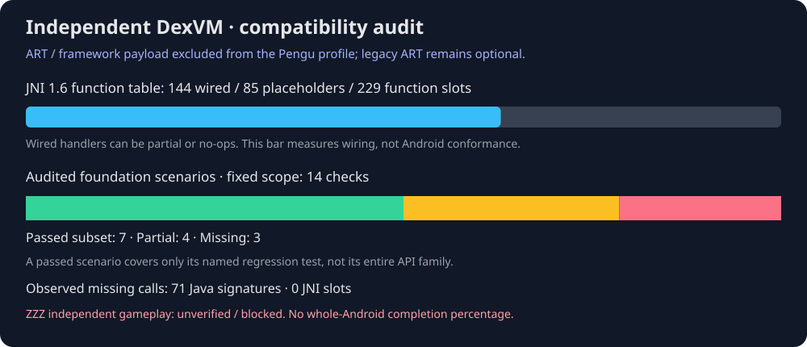
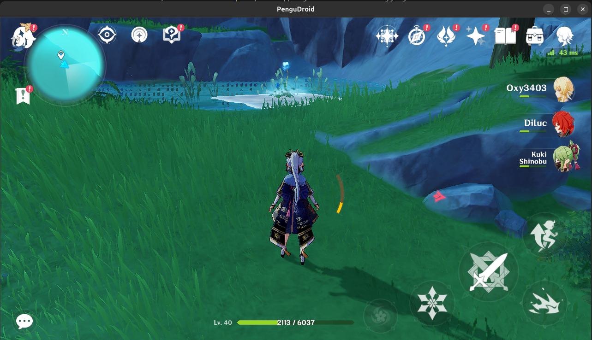
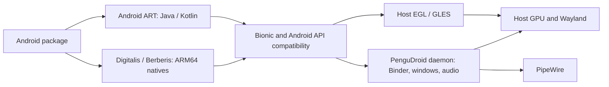

<div align="center">


# PenguDroid

**Android apps and ARM64 games on a Linux desktop.**

[Download the AppImage](https://github.com/denizomer10/PenguDroid/releases/latest) · [Current status](docs/STATUS.md) · [Architecture](docs/ARCHITECTURE.md) · [Known limitations](docs/LIMITATIONS.md)

</div>

PenguDroid runs Android applications as Linux processes through two Java execution paths. **Pengu** uses our own DEX interpreter, JNI host and core Java/Android implementations, without ART or framework JARs. It is experimental and has substantial compatibility gaps. The optional **ART** backend uses real Android runtime/framework components and carries the existing application evidence below. ARM64 native libraries use the Digitalis / Berberis bridge; graphics use the host GPU and Wayland, and audio uses PipeWire.

The target is Android 17 / API 37 on x86_64 Linux. No booted Android VM, container, root access or Android kernel is required. A component-based ART installation still contains Android binaries; an independent Pengu profile excludes them. See [the dependency audit and independent build](docs/INDEPENDENT_RUNTIME.md).

## Android compatibility index



This is a scoped audit, **not a whole-Android completion percentage**. JNI wiring includes partial/no-op handlers; a passing foundation scenario covers only its named regression test. Runtime observations list missing calls, not every possible missing API. See the [machine-readable index](docs/compatibility/index.json), [limitations](docs/LIMITATIONS.md) and [architecture](docs/ARCHITECTURE.md).

`pengudroid compat-index` reports the current binary's JNI table and ART/framework mappings. `PENGUDROID_COMPAT_REPORT=/path/report.json` records a Pengu launch when it returns. `PENGUDROID_VM_STRICT=1` rejects unresolved Java calls.

**ZZZ 3.3.0 is not yet working independently.** Pengu loads its DEX and ARM64 engine libraries without ART/framework, and now runs real worker threads, Looper queues and Unity nativeRender calls. SDK resource/UI, service and reflection gaps still block a verified playable result. The ART path reaches the login background; the blank SDK overlay is still unresolved. No responsive login or gameplay claim is made. [Details and remaining work](docs/INDEPENDENT_RUNTIME.md#zzz-330-result-and-remaining-work).

## Independent Pengu profile

```sh
./target/release/pengudroid launch /path/to/app.apk --backend pengu
```

`tools/build-appimage.sh --pengu --portable` builds a profile that excludes ART/framework payloads, disables automatic Android runtime setup, and selects DexVM in both GUI and CLI. ARM64 applications additionally need the verified native bridge, guest support and host C++ support. [Build instructions and measured optimizations](docs/INDEPENDENT_RUNTIME.md#build-and-inspect).

The ordinary build keeps its existing `auto` backend selection to preserve compatibility. `PENGUDROID_BACKEND=pengu` selects the independent path explicitly. The published 0.3.0 component AppImage described below is the ART compatibility profile, not an independent DexVM release.

## Hosted ART application evidence — real screenshots

### Genshin Impact 7.2.0 — historical NVIDIA validation

Genshin is excluded from the 0.3.0 validation scope; the earlier NVIDIA evidence below remains historical.



**Genshin Impact 7.2.0 working on NVIDIA GeForce RTX 3080 Founders Edition + Intel Core i3-12100F, with ARM64 Digitalis translation.**

The screenshot supplied from the working local build shows in-world gameplay, the character, party, map and HUD. It is an actual desktop window, not a mock-up. This establishes gameplay on the tested machine; it does not establish compatibility with every GPU, distribution, future game update or account flow. Game files and accounts are supplied by the user and are not included in the release.

### Beach Buggy Racing 2 — 2026.10.26

The 0.3.0 component AppImage was verified with game/menu rendering and injected input, without a physical Android system tree. The component development build also captured the live race below. See the [release validation](docs/COMPONENT_APPIMAGE_TESTS.md).


**Beach Buggy Racing 2 working on RTX 3080 + Core i3-12100F, with ARM64 Digitalis translation.**

The supported test package is the 2026.10.26 ARM64 XAPK. The older 2026.10.05 APKM fails during native startup in the clean release test.

Verified progression: Vector Unit splash → update/profile screens → title → live race. The recorded 120-second run presented 22,911 frames before the later frame-rate cap was introduced. That historical frame count is not an FPS promise for this release.

<details>
<summary>See the captured boot sequence</summary>


</details>

### NewPipe — v0.29.1


**NewPipe v0.29.1 working on RTX 3080 + Core i3-12100F through Android ART.** Its Java/Kotlin application code does not need ARM64 translation.

The feed renders network-fetched thumbnails. Video and audio paths use the hosted Android media framework; the repository also contains captured playback evidence:


## Install and run

1. Download `PenguDroid-0.3.0-x86_64.AppImage` from [Releases](https://github.com/denizomer10/PenguDroid/releases/latest).
2. Make it executable and open it:

   ```sh
   chmod +x PenguDroid-0.3.0-x86_64.AppImage
   ./PenguDroid-0.3.0-x86_64.AppImage
   ```

3. On the first launch, the manager verifies and installs its bundled runtime components into your user cache. Setup works offline and creates no Android `system/` or `apex/` tree. Keep at least **5 GiB of free space** for extraction and runtime setup, plus space for your games.
4. After setup completes, click **+** to install an `.apk`, `.apkm`, `.xapk` or `.apks` package. Select it in the library and click **Launch**.

The 0.3.0 release carries its own userspace libraries, loader, Python, native bridge and 39 verified host/ARM64 runtime components. You do not need Python, Rust, an Android SDK, an extracted sysroot or a separate ARM64 guest tree. Later launches reuse the installed components. Android ART/framework binaries remain runtime components; the full Android OS image is unnecessary.

**System requirements still apply:** an x86_64 Linux machine, a compatible Linux kernel, a Wayland desktop and working host graphics drivers. The AppImage cannot supply a kernel, compositor or a GPU's kernel driver. Other architectures and every Linux distribution have not been verified.

The release uses a pinned [static uruntime launcher](https://github.com/VHSgunzo/uruntime) configured to extract and run by default. **FUSE and `fusermount` are not required**, including for normal double-click startup. The first launch also caches the bundled userspace runtime; later starts reuse it.

### Your app library


The manager provides installation, per-app launch/stop/uninstall, persistent app data, frame-rate display preferences and keyboard mapping controls. Closing or stopping a stuck app is handled through its process group.

Android apps keep their data under the per-user PenguDroid data directory. The runtime cache and app data are separate: updating the AppImage does not require deleting game downloads or logging in again.

### CLI inside the same AppImage

```sh
./PenguDroid-0.3.0-x86_64.AppImage --cli --version
./PenguDroid-0.3.0-x86_64.AppImage --cli runtime
./PenguDroid-0.3.0-x86_64.AppImage --cli info /path/to/app.apk
./PenguDroid-0.3.0-x86_64.AppImage --cli launch /path/to/app.apkm
./PenguDroid-0.3.0-x86_64.AppImage --cli ps
./PenguDroid-0.3.0-x86_64.AppImage --cli stop
```

`PENGUDROID_SYSROOT` and `PENGUDROID_ARM64_GUEST_ROOT` remain available for explicit developer overrides.

For offline installation from separate ART/APEX, framework and native library
packages, see the [modular runtime workflow](docs/MODULAR_RUNTIME.md). Its component
installation uses descriptor-backed paths without a physical `system/` or `apex/`
tree. The host payload is 71.3% smaller than the original API-37 tree; an optional
ARM64 provider also replaces the separate guest sysroot. `--with-modules STORE`
bundles the providers for offline AppImage first-run setup.

## What runs underneath



The host implements the framework contracts that normally come from Android services: package metadata, activity lifecycle, surfaces, input, networking and audio. The daemon brokers shared resources while applications remain ordinary host processes. Game controllers are covered in [CONTROLLERS.md](docs/CONTROLLERS.md). See [ARCHITECTURE.md](docs/ARCHITECTURE.md) for the boundaries and [NATIVE_BRIDGE.md](docs/NATIVE_BRIDGE.md) for ARM64 translation.

## Compatibility boundaries

- The screenshots prove specific application versions on the stated hardware. They are not a general Android compatibility certification or a performance benchmark.
- A working Wayland/GPU environment is required. An X11-only desktop is not the tested path.
- WebView uses the runtime's actual Chromium provider through the hosted framework. Its in-process configuration is a compatibility path, not Android's isolated renderer-service architecture.
- Google Play services, billing, DRM, device integrity, cameras and hardware-dependent APIs are not full Android implementations. Purchases and protected-service compatibility are not claimed.
- Hardware video decoding depends on the host GPU and backend; software decoding remains relevant. See [HARDWARE_VIDEO.md](docs/HARDWARE_VIDEO.md).
- Games can require large additional downloads and may change behavior after an update. PenguDroid does not include commercial APKs, game data or user credentials.

[STATUS.md](docs/STATUS.md) records measured behavior and outstanding work. [LIMITATIONS.md](docs/LIMITATIONS.md) describes the remaining gaps; older investigation notes there are historical when explicitly superseded.

## Build from source

```sh
git clone https://github.com/denizomer10/PenguDroid.git
cd PenguDroid
cargo build --release --workspace
```

Runtime preparation and translation inputs are documented in [ANDROID17.md](docs/ANDROID17.md) and [NATIVE_BRIDGE.md](docs/NATIVE_BRIDGE.md). To assemble the portable release after preparing the bridge and guest bundle:

```sh
tools/build-appimage.sh --portable --with-bridge \
  --with-modules .toolchain/runtime-components-store \
  --output target/PenguDroid-0.3.0-x86_64.AppImage
```

The build host needs the prepared component store and native bridge, plus `appimagetool` or `mksquashfs`; these are build dependencies. See [component preparation](docs/MODULAR_RUNTIME.md). The legacy `--with-runtime` option is retained for development comparisons.

### Validation

```sh
cargo test --workspace --offline
python3 -B -m unittest discover -s tools
```

Some integration tests need the local Android runtime, graphics session or pinned native toolchain. Release verification must additionally exercise the packaged artifact from an unrelated working directory with a fresh user cache, verify runtime download/preparation and relaunch, and test real application launch/stop. Source-tree test results alone do not prove that an AppImage contains all of its dependencies.

## Documentation and license

[CLI and protocol](docs/API.md) · [Android runtime](docs/ANDROID17.md) · [Native bridge](docs/NATIVE_BRIDGE.md) · [Hardware video](docs/HARDWARE_VIDEO.md) · [Limitations](docs/LIMITATIONS.md)

PenguDroid is licensed under [Apache-2.0](LICENSE). Bundled third-party components retain their own licenses. Android runtime downloads are obtained separately from their official source. Genshin Impact, Beach Buggy Racing 2, NewPipe and their respective marks belong to their owners; the screenshots demonstrate compatibility and do not imply endorsement.
