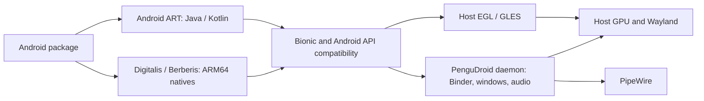

<div align="center">


# PenguDroid

**Android apps and ARM64 games on a Linux desktop.**

[Download the AppImage](https://github.com/denizomer10/PenguDroid/releases/latest) · [Current status](docs/STATUS.md) · [Architecture](docs/ARCHITECTURE.md) · [Known limitations](docs/LIMITATIONS.md)

</div>

PenguDroid runs Android applications as Linux processes. Java and Kotlin code use real Android ART; ARM64 native libraries run through the **Digitalis / Berberis ARM64-to-x86_64 bridge**. Graphics go to the host GPU and Wayland desktop, and audio goes to PipeWire. No Android virtual machine, container, root access or Android kernel is required at runtime.

The runtime target is **Android 17 / API 37 on x86_64 Linux**. This is a working compatibility layer under active development, not a promise that every Android application is supported.

## Working applications — real screenshots

### Genshin Impact 7.2.0


**Genshin Impact 7.2.0 working on NVIDIA GeForce RTX 3080 Founders Edition + Intel Core i3-12100F, with ARM64 Digitalis translation.**

The screenshot supplied from the working local build shows in-world gameplay, the character, party, map and HUD. It is an actual desktop window, not a mock-up. This establishes gameplay on the tested machine; it does not establish compatibility with every GPU, distribution, future game update or account flow. Game files and accounts are supplied by the user and are not included in the release.

### Beach Buggy Racing 2 — 2026.10.26


**Beach Buggy Racing 2 working on RTX 3080 + Core i3-12100F, with ARM64 Digitalis translation.**

The supported test package is the 2026.10.26 ARM64 XAPK. The older 2026.10.05 APKM fails during native startup in the clean release test.

Verified progression: Vector Unit splash → update/profile screens → title → live race. The recorded 120-second run presented 22,911 frames before the later frame-rate cap was introduced. That historical frame count is not an FPS promise for this release.

<details>
<summary>See the captured boot sequence</summary>


</details>

### NewPipe — v0.29.1


**NewPipe v0.29.1 working on RTX 3080 + Core i3-12100F through Android ART.** Its Java/Kotlin application code does not need ARM64 translation.

The feed renders network-fetched thumbnails. Video and audio paths use the hosted Android media framework; the repository also contains captured playback evidence:


## Install and run

1. Download `PenguDroid-x86_64.AppImage` from [Releases](https://github.com/denizomer10/PenguDroid/releases/latest).
2. Make it executable and open it:

   ```sh
   chmod +x PenguDroid-x86_64.AppImage
   ./PenguDroid-x86_64.AppImage
   ```

3. On the first launch, the manager downloads the pinned Android sysimage from Google's server, verifies its SHA-256, and extracts the runtime into your user cache. Progress appears in the manager. Keep an internet connection and at least **12 GiB of free space** for preparation.
4. After setup completes, click **+** to install an `.apk`, `.apkm`, `.xapk` or `.apks` package. Select it in the library and click **Launch**.

The release carries its own userspace libraries, loader, Python, image-extraction tools, native bridge and built ARM64 guest bundle. You do not need to install Python, Rust, an Android SDK, `debugfs` or `erofs-utils` to use this AppImage. The Android sysimage is downloaded on your machine rather than redistributed inside the release. Later launches reuse the installed runtime.

**System requirements still apply:** an x86_64 Linux machine, a compatible Linux kernel, a Wayland desktop and working host graphics drivers. The AppImage cannot supply a kernel, compositor or a GPU's kernel driver. Other architectures and every Linux distribution have not been verified.

The release uses a pinned [static uruntime launcher](https://github.com/VHSgunzo/uruntime) configured to extract and run by default. **FUSE and `fusermount` are not required**, including for normal double-click startup. The first launch also caches the bundled userspace runtime; later starts reuse it.

### Your app library


The manager provides installation, per-app launch/stop/uninstall, persistent app data, frame-rate display preferences and keyboard mapping controls. Closing or stopping a stuck app is handled through its process group.

Android apps keep their data under the per-user PenguDroid data directory. The runtime cache and app data are separate: updating the AppImage does not require deleting game downloads or logging in again.

### CLI inside the same AppImage

```sh
./PenguDroid-x86_64.AppImage --cli --version
./PenguDroid-x86_64.AppImage --cli runtime --download
./PenguDroid-x86_64.AppImage --cli info /path/to/app.apk
./PenguDroid-x86_64.AppImage --cli launch /path/to/app.apkm
./PenguDroid-x86_64.AppImage --cli ps
./PenguDroid-x86_64.AppImage --cli stop
```

`PENGUDROID_SYSROOT` and `PENGUDROID_ARM64_GUEST_ROOT` remain available for explicit developer overrides.

## What runs underneath



The host implements the framework contracts that normally come from Android services: package metadata, activity lifecycle, surfaces, input, networking and audio. The daemon brokers shared resources while applications remain ordinary host processes. See [ARCHITECTURE.md](docs/ARCHITECTURE.md) for the boundaries and [NATIVE_BRIDGE.md](docs/NATIVE_BRIDGE.md) for ARM64 translation.

### Native gralloc presentation on Aurora/Hybris

On AArch64 Aurora devices, Android ARM64 code runs natively. The current EGL/GLES presentation path uses the device's native gralloc instead of translating the code or reading every frame back through the CPU:

1. The graphics shim calls `hybris_gralloc_allocate` and requests a **linear BGRA** buffer. The allocation is mmap-able and has a native file descriptor.
2. The buffer is imported into the isolated host GLES namespace as an **EGLImage**, then connected to a texture/FBO so Android HWUI can render into it.
3. When the guest and host vertical orientations differ, the frame is flipped on the GPU with `glBlitFramebuffer`. The alternative shader-flip path remains optional; it was not faster on the tested device.
4. The native fd is sent to the PenguDroid daemon using `SCM_RIGHTS` in a `PresentShm` request. The daemon imports it into a Wayland `wl_shm_pool`, attaches the resulting buffer to the existing application surface and commits it. There is no second launcher window or late surface replacement.
5. The hosted `IDisplayEventConnection.requestNextVsync` returns a real Status and emits a one-shot Android DisplayEvent through the broker. Aurora uses this request-driven mode by default; `PENGUDROID_VSYNC_ON_PRESENT=1` retains the optional present-pulse compatibility mode. Neither path is a free-running 60 Hz producer.

Aurora/Hybris package launches enable `PENGUDROID_GRALLOC=1` and `PENGUDROID_GRALLOC_SHM=1` automatically. `PENGUDROID_FORCE_SHM=1` retains the verified CPU `glReadPixels`/shared-memory fallback; `PENGUDROID_FORCE_DMABUF=1` selects the dma-buf path when the compositor supports it. The current Lipstick setup exposes neither a suitable `linux-dmabuf` nor `wl_drm` path, so native fd transport into `wl_shm` is used instead.

A `PresentShm` reply confirms daemon acceptance/attachment, not physical scanout. Visible-frame validation therefore also uses compositor screenshots and pixel/content changes, not just EGL swap counters. Implementation boundaries live in [`pengudroid-gleshim`](crates/pengudroid-gleshim/src/lib.rs) and the daemon's [`graphics.rs`](crates/pengudroid-daemon/src/graphics.rs).

## Compatibility boundaries

- The screenshots prove specific application versions on the stated hardware. They are not a general Android compatibility certification or a performance benchmark.
- A working Wayland/GPU environment is required. An X11-only desktop is not the tested path.
- WebView uses the runtime's actual Chromium provider through the hosted framework. Its in-process configuration is a compatibility path, not Android's isolated renderer-service architecture.
- Google Play services, billing, DRM, device integrity, cameras and hardware-dependent APIs are not full Android implementations. Purchases and protected-service compatibility are not claimed.
- Hardware video decoding depends on the host GPU and backend; software decoding remains relevant. See [HARDWARE_VIDEO.md](docs/HARDWARE_VIDEO.md).
- Games can require large additional downloads and may change behavior after an update. PenguDroid does not include commercial APKs, game data or user credentials.

[STATUS.md](docs/STATUS.md) records measured behavior and outstanding work. [LIMITATIONS.md](docs/LIMITATIONS.md) describes the remaining gaps; older investigation notes there are historical when explicitly superseded.

## Build from source

```sh
git clone https://github.com/denizomer10/PenguDroid.git
cd PenguDroid
cargo build --release --workspace
```

Runtime preparation and translation inputs are documented in [ANDROID17.md](docs/ANDROID17.md) and [NATIVE_BRIDGE.md](docs/NATIVE_BRIDGE.md). To assemble the portable release after preparing the bridge and guest bundle:

```sh
tools/build-appimage.sh --portable --with-bridge
```

The build host needs the packaging inputs and `appimagetool`; these are build dependencies, not packages the end user must install. `--with-runtime` is a local testing option and is not used for the downloadable release.

### Validation

```sh
cargo test --workspace --offline
python3 -B -m unittest discover -s tools
```

Some integration tests need the local Android runtime, graphics session or pinned native toolchain. Release verification must additionally exercise the packaged artifact from an unrelated working directory with a fresh user cache, verify runtime download/preparation and relaunch, and test real application launch/stop. Source-tree test results alone do not prove that an AppImage contains all of its dependencies.

## Documentation and license

[CLI and protocol](docs/API.md) · [Android runtime](docs/ANDROID17.md) · [Native bridge](docs/NATIVE_BRIDGE.md) · [Hardware video](docs/HARDWARE_VIDEO.md) · [Limitations](docs/LIMITATIONS.md) · [Experimental Aurora/AArch64 port](docs/AURORA.md)

PenguDroid is licensed under [Apache-2.0](LICENSE). Bundled third-party components retain their own licenses. Android runtime downloads are obtained separately from their official source. Genshin Impact, Beach Buggy Racing 2, NewPipe and their respective marks belong to their owners; the screenshots demonstrate compatibility and do not imply endorsement.
