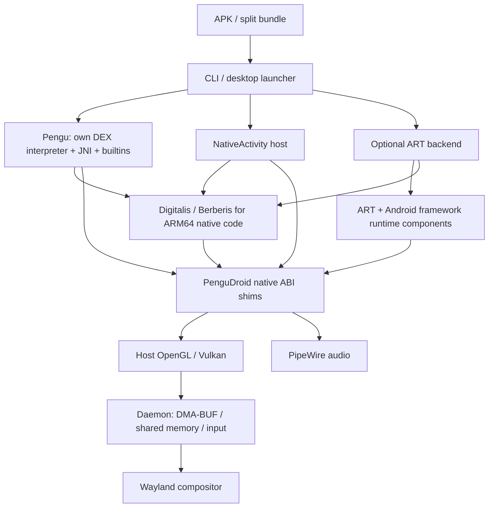

# PenguDroid architecture

PenguDroid runs hosted applications as Linux processes. It has three execution
paths with different dependencies and compatibility boundaries. See
[the independent runtime audit](INDEPENDENT_RUNTIME.md) and
[the measured compatibility index](compatibility/index.json).

## Execution and host services

Neither a guest Android kernel nor a booted Android VM/container is required.
The host kernel, compositor and graphics driver remain real system requirements.
The compatibility layer is not a general Android security boundary.

## Independent DEX and JNI runtime

`pengudroid-dexvm` parses DEX tables, indexes classes and methods, interprets
bytecode and stores objects in its heap. Parsed method code uses shared immutable
storage. First-definition class identity is preserved across DEX loads. The heap
currently retains objects; there is no complete garbage collector.

Java/Android builtins implement a limited subset of core classes, application
paths, messages, strings, collections and synchronization helpers. Unresolved
calls are counted and logged. Strict diagnostic mode rejects missing calls; the
normal experimental mode retains descriptor defaults for compatibility with the
prototype. A successful lifecycle return does not imply successful rendering.

The JNI host provides a function table and object/method/field handles. Native
outbound calls use cached libffi interfaces with typed arguments/returns. JNI
ellipsis, `va_list` and `jvalue` entry points use a C adapter. JNI string APIs handle
UTF-16 and modified UTF-8; pending exceptions are carried back to the interpreter.
Reference management, reflection, monitors and threading remain incomplete.

Native ARM64 libraries use the same translator/proxy infrastructure as the other
backends. The translator needs host C++ support and an ARM64 native support bundle;
these are distinct from ART and framework JARs. The independent ARM64 package
contains only a dependency-checked native closure in a flat `native/` directory;
its descriptor maps native ABI paths without materializing `system/` or `apex/`. An independent build contains no
ART/framework module store and never provisions a fallback ART runtime.

## Optional hosted Android framework

The `art` backend uses real ART and framework classes. Its component runtime maps
Android ABI paths to individual verified payloads through `pengudroid-runtime`.
It can operate without a physical `system/` / `apex/` tree, but still requires ART
and framework binaries. Legacy explicit sysroots remain supported in normal
builds. Their provenance descriptor is distinguished from a component manifest.

The activity host supplies the framework's service/session replies, application
metadata, lifecycle dispatch, display configuration and input injection. This path
contains the existing Genshin/BBR2/NewPipe evidence. That evidence does not establish
independent DexVM compatibility.

## Graphics and input

`pengudroid-gleshim` redirects Android EGL surfaces to host GPU targets and presents
exported DMA-BUFs through the daemon. `pengudroid-vkshim` implements Android Vulkan
WSI with host Vulkan images. Vulkan and GL carry explicit orientation metadata.

On RTX 3080, linear SRGB images cannot serve as the requested swapchain color
attachments. Vulkan WSI therefore enumerates and validates exportable single-plane
DRM modifiers, allocates with a validated modifier, and submits its real modifier,
stride and offset. Hosts without the extension retain the linear allocation path.
The real-GPU SRGB swapchain allocation test is opt-in.

Vulkan surface creation subscribes to the shared input queue. In the ART host,
touch selection uses touchability flags independently of keyboard focus, and
removed/hidden/stopped roots are excluded. The applied framework frame is
`ViewRootImpl.mWinFrame`; `ClientWindowFrames` is a relayout payload, not that root
member. These contracts are checked against the real framework.

Physical controller events use the existing evdev/hotplug reader. The ART input
service advertises one normalized Xbox One device (ID 2, vendor/product
`045e:02dd`), with an Xbox 360 identity option (`045e:028e`). Events carry the same
logical device ID and standard Android axes. Independent DexVM does not yet provide
the complete Android InputManager/UI event path. See [controllers](CONTROLLERS.md).

## Packaging and verification

`tools/build-appimage.sh --pengu` creates the independent profile. It refuses
ART/framework runtime/module options, marks the profile, and disables automatic
runtime setup in both launchers. `--portable` packages the host userspace closure,
including libffi. It cannot bundle a compatible host kernel or GPU kernel driver.

The existing 0.3.0 component profile is a separate, ART-dependent distribution.
[Modular runtime documentation](MODULAR_RUNTIME.md) explains its verified install
and path mapping contracts. [API documentation](API.md) describes the CLI and
broker protocol. [Limitations](LIMITATIONS.md) distinguishes tested subsets from
unimplemented services and game compatibility.
