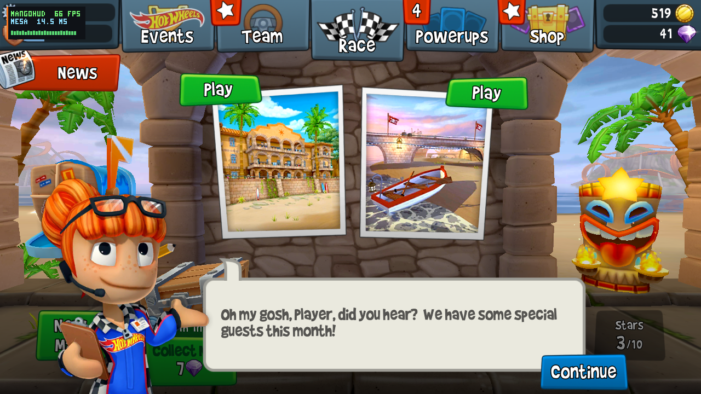

# Component AppImage validation — 0.3.0

Validated on 2026-11-16 using the packaged release, an isolated user cache/data
location and an unrelated working directory. Genshin was excluded at the user's
request. Android ART/framework binaries remain component providers; no physical
Android system tree is required by this installation.

## Artifact

| Field | Value |
| --- | --- |
| File | `PenguDroid-0.3.0-x86_64.AppImage` |
| Bytes | 467,552,704 |
| SHA-256 | `dc3fa8c18b305dec2ecc256ad7ec68fd1f210c0501e14eafc8bbddbb11bef064` |
| CLI version | `pengudroid 0.3.0` |
| Runtime target | Android 17 / API 37, x86_64 host |
| Providers | 39, including the independent ARM64 guest component |

Build command:

```sh
tools/build-appimage.sh --portable --with-bridge \
  --with-modules .toolchain/runtime-components-store \
  --output target/PenguDroid-0.3.0-x86_64.AppImage
```

## Completed checks

| Check | Result |
| --- | --- |
| Rust workspace suite | 470 test results passed |
| Python tool suite | 275 tests: 265 passed, 10 optional build-SDK tests skipped |
| Actual component CheckJNI probes | All 7 passed: activities, audio, BLAST, core services, main dispatch, media discovery and process identity |
| Actual ARM64 bridge | Initialized from the component provider; a translated function returned `42` |
| Release build and AppImage packaging | Passed |
| Fresh component setup, `PATH=/nonexistent` | Passed in 83.19 seconds; no download requested |
| Old per-user sysroot sentinel | An API-33 sentinel in the legacy data location was ignored; component setup remained API 37 |
| Installed physical layout | `components/`, `state/` and descriptors; no `system/`, `apex/` or `build.prop` |
| Guest environment | Runtime descriptor present; `PENGUDROID_ROOT` and `PENGUDROID_ARM64_GUEST_ROOT` absent |
| Packaged BBR2 2026.10.26 | Alive for 160.71 seconds; 5,911 game-surface presents at 1280×720 |
| Packaged input commands | Tap at 65.26 s, left key at 75.40 s and right key at 120.62 s all returned success |
| Cleanup | Private game and daemon process groups stopped/reaped by the harness |
| Final checksum verification | `sha256sum -c SHA256SUMS` passed |

The skipped tests compile native-bridge sources against a separately verified
API-37 build SDK. This machine has the built translator/guest runtime but lacks
that SDK's successful preflight manifest. Skips are explicit; they are not a
claim that the translator was rebuilt from source during this release.

The seven framework probes were enabled explicitly against a component
installation, in addition to the ordinary workspace suite's optional probes.
ART uses its existing imageless fallback after a boot-image read-barrier
mismatch. No fatal JNI or bridge-signal marker occurred in the packaged BBR2 run.
Expected unavailable Google billing/Play-services diagnostics remain visible.

## Captured game output

The final 0.3.0 image rendered the game/menu scene and accepted the recorded
commands. Its captured frame is below. This is not an FPS benchmark or proof of
a completed race, purchase, account login or every game feature.



The preceding component development build also reached a live race using the
same tree-free layout. Its separate 180-second run and 160-second input run
remained alive; the latter captured this race frame. This historical component
build image is kept separate from the final release capture above.


## Reproduction

Prepare the component store and ARM64 provider as described in
[MODULAR_RUNTIME.md](MODULAR_RUNTIME.md). Use a fresh cache/data pair for setup,
then launch the real package through the AppImage:

```sh
# Use absolute paths; keep the actual Wayland session's XDG_RUNTIME_DIR.
export XDG_CACHE_HOME=/absolute/test/cache
export XDG_DATA_HOME=/absolute/test/data
/absolute/PenguDroid-0.3.0-x86_64.AppImage --cli runtime

PENGUDROID_APPIMAGE=/absolute/PenguDroid-0.3.0-x86_64.AppImage \
SMOKE_DIR=/absolute/test/bbr2 SMOKE_SECONDS=160 SMOKE_BACKEND=art \
PENGUDROID_TRACE_PRESENTS=1 \
python3 -B tools/smoke_bundle.py /path/to/Beach-Buggy-Racing-2.xapk
```

The harness launches both game and daemon through the AppImage entry point.
For timed input it accepts `SMOKE_ACTIONS` JSON (`at`, `args`) and an optional
`SMOKE_CONTROL_ENTRY` argv list. The recorded run used the **packaged persistent
CLI/bootstrap** for control commands, avoiding repeated SquashFS extraction
while the game was running. No developer CLI/daemon was substituted for the
packaged launch.

Raw build/test logs, bootstrap metadata, process-environment evidence, actions
and frame captures were retained locally under `target/release-validation/`.
The release contains no commercial game packages, user game data or credentials.
